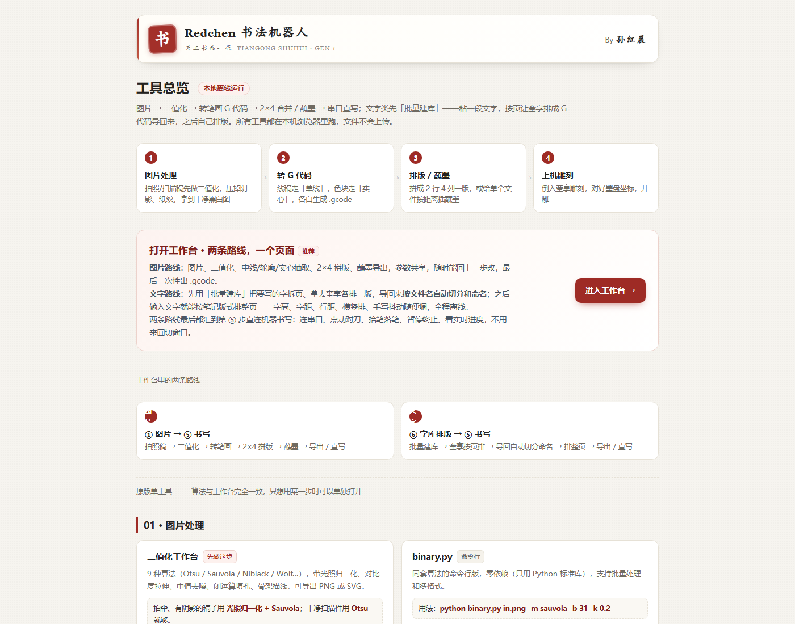
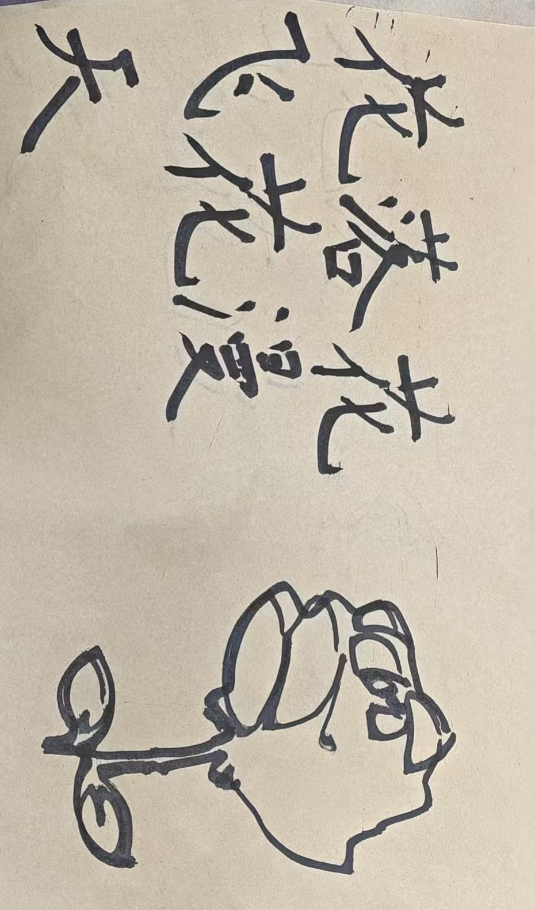
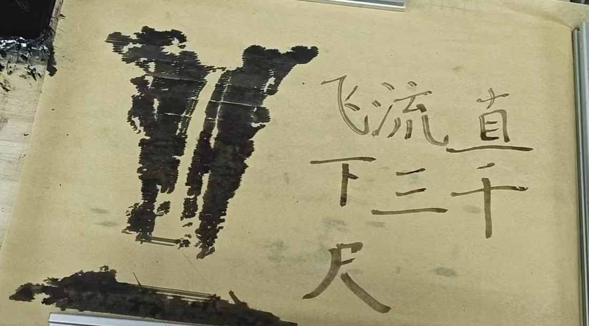
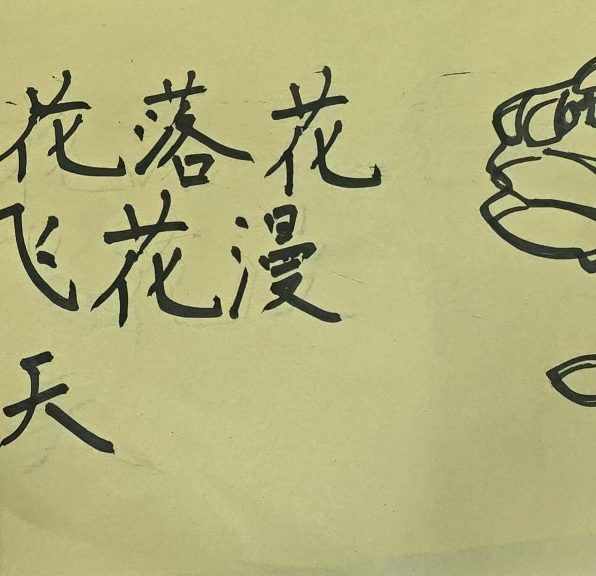
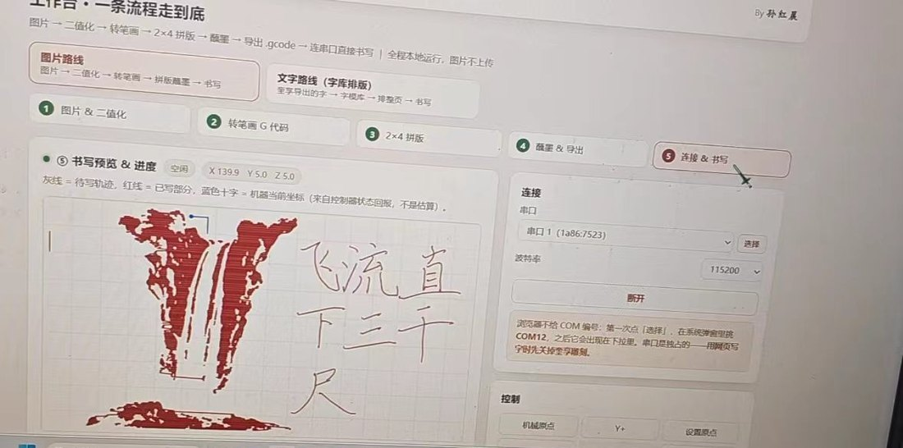
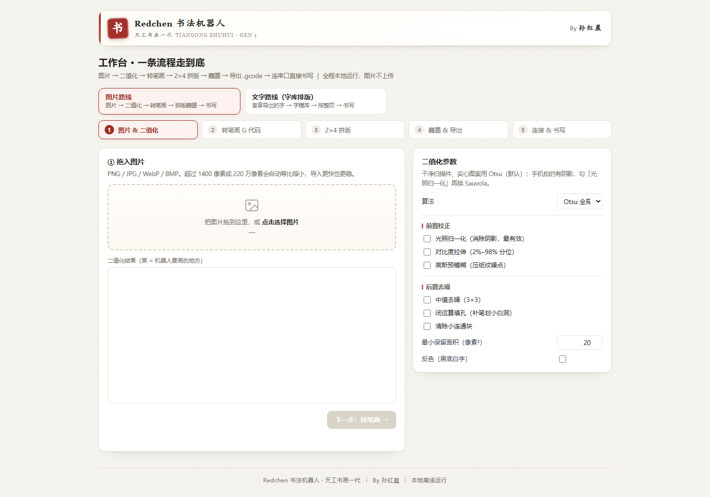
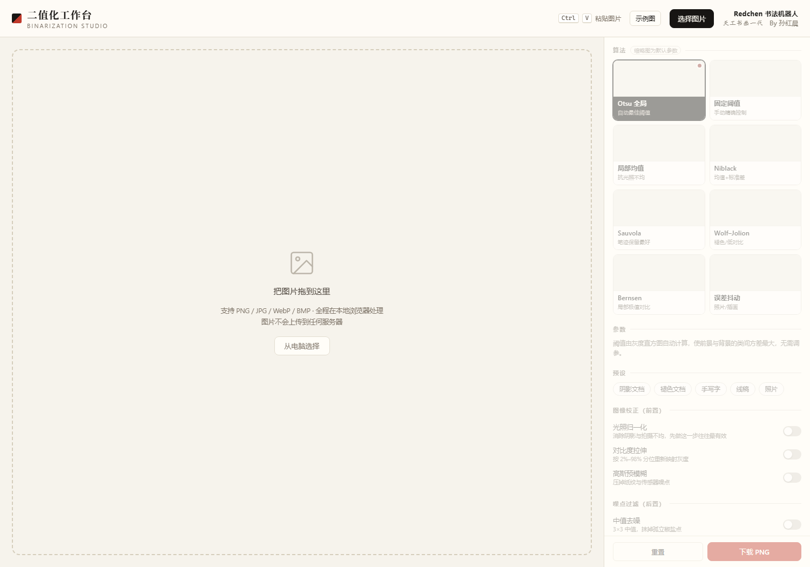

# 书法机器人 · 天工书画一代

**Redchen 书法机器人控制台 —— 把图片和文字变成能上机书写的 G 代码**

[](LICENSE)
[]()
[]()
[](https://github.com/LinuxRedchen/Calligraphy-Robot-With-Brush/pulls)

天工毛笔书法机器人（一代，步进电机 + GRBL 结构）的开源控制台。全部工具都是**纯前端网页**，双击 HTML 就能用，不需要装软件、不需要起服务器、**图片不上传任何服务器**。生成的 G 代码可以直接在浏览器里通过 Web Serial 连机器书写。

> 适用于参加毛笔书法机器人比赛、做写字机 / 绘图机 / 毛笔机器人类项目，或者只是想把手写字搬上纸。



---

## 写在纸上的效果

以下全部是**实拍照片**，不是渲染图。同一套工具，换纸、换笔、换墨都能写。

| 诗句 + 手绘插画（一次 2×4 拼版写出） | 手写体诗句 + 粗笔画填充（同一张纸） |
|:---:|:---:|
|  |  |
| **换纸换墨同样稳** | **第 ⑤ 步串口直连书写，红色是已写部分** |
|  |  |

左列两张都是「字 + 画」混排：细笔画的手写体走中线模式、粗墨块走实心填充，两种下压深度在同一版里分开设定。右上是大墨块实心填充的效果。右下图是工作台第 ⑤ 步的真实状态——机器正在写，红色是已完成轨迹，蓝色十字是从控制器 `?` 回报拿到的当前坐标，不是估算。

---

## 目录

- [写在纸上的效果](#写在纸上的效果)

- [它能做什么](#它能做什么)
- [快速开始](#快速开始)
- [两条工作路线](#两条工作路线)
- [目录结构](#目录结构)
- [机器参数速查](#机器参数速查)
- [G 代码格式](#g-代码格式)
- [命令行工具](#命令行工具)
- [实现要点](#实现要点)
- [常见问题](#常见问题)
- [与商业软件的边界](#与商业软件的边界)
- [参与贡献](#参与贡献)
- [许可证](#许可证)

---

## 它能做什么

| 环节 | 能力 |
|---|---|
| **图片 → 黑白** | 9 种二值化算法（Otsu / 固定阈值 / 局部均值 / Niblack / Sauvola / Wolf–Jolion / Bernsen / 抖动 / 骨架），带光照归一化、对比度拉伸、开闭运算、去小连通块 |
| **图片 → 笔画** | 三种描线模式：**中线**（线稿、毛笔字）、**轮廓**（实心色块、印章）、**实心**（平行线填充），输出按笔画组织的 G 代码 |
| **拼版** | 2 行 × 4 列共 8 格拼版，按格设定「字 / 画」不同的下压深度，自动缩放、调列间距行间距 |
| **蘸墨** | 按累计笔画长度自动插入蘸墨动作：抬笔 → 去墨盘 → 下压吸墨 → 移开 → 刮墨 → 回断点继续画 |
| **字库排版** | 把排版软件排好的字形 G 代码切成单字字模，离线存进浏览器；之后输入文字即可整页排版（字高/字距/行距/竖排/居中/手写抖动） |
| **直连书写** | Web Serial 连 GRBL：机械原点 `$H`、设置原点、点动、抬笔落笔、解除警报、书写/暂停/终止、实时进度与通信日志 |

全部离线，纯 `HTML + CSS + JS`，无构建步骤、无 npm 依赖、无后端。

---

## 快速开始

**只需要一个文件：`工作台.html`。**

1. 下载本仓库（`Code → Download ZIP`，或 `git clone`）
2. 双击 `工作台.html`（用 **Edge / Chrome**，必须是 Chromium 内核）
3. 按顶部步骤条走：① 图片 & 二值化 → ② 转笔画 → ③ 拼版 → ④ 蘸墨 & 导出 → ⑤ 连接 & 书写

> `index.html` 是总入口页，从那里可以进工作台，也能单独打开某一个工具。
> 所有参数自动存在浏览器本地，下次打开还在。

### 第一次上机建议顺序

```
拖一张简单的图 → Otsu 二值化 → 中线模式转笔画 → 成品宽度设 60mm
→ 预览确认轨迹 → 导出 .gcode → 用商业排版软件先跑一遍确认机器参数
→ 再用工作台第 ⑤ 步直连书写
```

**一定先拿一小段试写。** 毛笔机器人的 Z 下压深度、F 速度、墨盘坐标都跟纸、笔、墨、机器强相关，参数错了会顶穿纸或抬不起笔。



---

## 两条工作路线

工作台顶部有两个入口，共用最后一步「连接 & 书写」：

### 图片路线（① → ⑤）

```
图片 → 二值化 → 转笔画 G 代码 → 2×4 拼版 → 蘸墨 → 导出 / 直接书写
```

适合：单线字、线稿、印章、图案、实心色块。

### 文字路线（⑥ → ⑤）

```
批量建库 → 让排版软件排一版 → 导入 G 代码自动切分成字模 → 输入文字整页排版 → 导出 / 直接书写
```

适合：整篇诗文、名单、多行手写体。字模是一次性投入，攒够常用字之后全程离线，不必再开排版软件。

> 详细操作（含每个参数的含义、踩坑经验）见 **[使用说明.md](使用说明.md)**，那里写得比这里细得多。



---

## 目录结构

```
书法机器人/
├─ index.html                   入口总览页
├─ 工作台.html                  ★ 主程序：两条路线、五个步骤全在这一个文件里
├─ 使用说明.md                  完整使用文档（参数详解 + FAQ）
├─ 01_图片处理/
│  ├─ 二值化/index.html         二值化工作台（9 种算法，导出 PNG）
│  ├─ 二值化/binary.py          同套算法的命令行版（零依赖，只用标准库）
│  ├─ 图片转单线.html           图片 → 按笔画描线的 G 代码
│  └─ 图片转实心.html           图片 → 平行线填充的 G 代码
├─ 02_G代码处理/
│  ├─ 合并工具.html             最多 8 份 G 代码拼成 2 行 × 4 列
│  ├─ 蘸墨工具.html             单个 G 代码按距离插蘸墨（网页版）
│  ├─ add_ink.sh                蘸墨脚本本体（参数集中在文件顶部）
│  └─ 蘸墨处理.bat              拖拽入口，把 .gcode 拖上去就自动蘸墨
└─ docs/                        README 用截图
```

`01_`、`02_` 里的单工具与工作台**算法完全一致**（同一张图、同一组参数，导出的 G 代码逐字节相同），只想用某一步时可以单独打开。

---

## 机器参数速查

默认值是天工书画一代（步进电机模式）实测可用的配置：

| 项目 | 默认值 | 说明 |
|---|---|---|
| 落笔 Z | **5** | Z 越大压得越深越重；想让字更重调到 6~7，画更轻调到 2~3 |
| 抬笔 Z | **0** | 一般不动 |
| F 速度 | **10000** | 必须与导出文件里的 `F` 一致，否则蘸墨插入点会错位 |
| 波特率 | **115200** | 与 GRBL 固件一致 |
| 蘸墨间隔 | **400 mm** | 累计笔画长度触发 |
| 蘸墨停留 | **0.8 s** | 设 0 则不插 `G4`（固件不认 `G4` 时用） |
| 墨盘 X / Y | 按实际量 | 量**墨盘中心**的机器坐标，不是纸上的位置 |

---

## G 代码格式

脚本按这套格式识别并插入蘸墨动作，**格式变了就会错位**：

| 动作 | G 代码 |
|---|---|
| 抬笔 | `G1G90 Z0.0F10000` |
| 落笔 | `G1G90 Z5.0F10000` |
| 空移 | `G0 X18.256Y6.085F10000` |
| 画线 | `G1 X17.198Y6.350F10000` |
| 回零 | `G90G0 X0Y0` |

用的是标准 GRBL 方言（G0/G1/G4/G90/G92/M18/$H/$X/`?` 状态查询），其他 GRBL 机器改改 Z、F、波特率也能用。改版或换软件后，先跑 3~5 行的短文件验证。

---

## 命令行工具

### `add_ink.sh` —— 蘸墨后处理

```bash
./add_ink.sh 输入.gcode              # 自动生成 输入_蘸墨.gcode
./add_ink.sh 输入.gcode 输出.gcode    # 指定输出名
```

参数全部集中在文件顶部的参数区（墨盘 XY、下压 Z、停留秒数、蘸墨间隔、刮墨开关/方向/距离），改完直接生效。

Windows 上可以直接把 `.gcode` 拖到 `蘸墨处理.bat` 上；脚本会自动在常见安装路径和 `PATH` 里找 `bash.exe`（找不到就提示装 Git for Windows，也可以用环境变量 `BASH_PATH` 指定）。

### `binary.py` —— 二值化命令行版

零依赖，只用 Python 标准库（自带 PNG 解码，支持灰度/RGB/调色板/RGBA、8/16 位，以及 PGM/PPM）。

```bash
python binary.py photo.png                      # 自动 Otsu
python binary.py in.png -o out.png -m sauvola -b 31 -k 0.2
python binary.py in.png -m mean -b 25 -c 8 --denoise
python binary.py a.png b.png --outdir ./out     # 批量
python binary.py in.png --preview               # 只看统计不写文件
```

算法：`otsu`（光照均匀的扫描件）／`fixed`（固定阈值）／`mean`（抗光照不均）／`sauvola`（笔迹保留最好）／`dither`（照片、插画）。

---

## 实现要点

想改代码或者移植到别的机器，这几处是关键：

**二值化** —— 局部阈值用**积分图** O(1) 取窗口均值/方差；Bernsen 的局部 min/max 用**单调队列**做水平 + 垂直分离，整体 O(n)；Otsu 在阈值平台区取最小值（与 OpenCV 行为一致）。光照归一化 = 大窗口（短边/8）均值作背景估计 + 除法拉伸白场，对手机拍摄的阴影很有效。

**抽笔画** —— 先用 Zhang-Suen 细化得到单像素骨架，再按 8 邻接跟踪成笔画序列，结点处分叉拆成独立笔画。这就是中线模式在粗体字上会出现断口和小分叉的原因（算法特性，不是 bug）；要连通的闭合轮廓就用轮廓模式。

**性能** —— 图片解码放到 Web Worker，预览最长边限制 1500px 保证拖动滑块不卡；导入超过 1400px 或 220 万像素自动等比缩小；抽笔画延后到进第 2 步时才做，并按参数 key 缓存中间结果。

**串口书写** —— Web Serial API 直连 GRBL，按字符流控（等 `ok` 回执才发下一行），15 秒无 `ok` 自动停发并告警；`?` 状态查询回来的机器坐标画成预览里的蓝色 L 形十字。

**为什么全是单文件 HTML** —— 比赛现场和别人的电脑上往往不能装环境、不能联网。单文件、零依赖、`file://` 直接打开，是最不容易出问题的分发方式。

---

## 常见问题

**连不上机器 / 串口被占用？**
先关掉其他占着串口的软件（排版软件开着时串口是独占的）；波特率 115200；换根数据线；只能在 Edge / Chrome 里用，并且必须在**点击**按钮弹出的系统窗口里授权，不能自动弹。

**写字过程中机器不动、进度卡住？**
看第 ⑤ 步的通信日志。15 秒没有 `ok` 就多半是波特率不对或固件不是 GRBL。出现 `ALARM` 点「解除警报」`$X` 后重新设置原点。

**单线出来的字变形、笔画变细？**
二值化别对文字用「骨架描线」，它会提取中心线并平滑，笔画会变形。文字用 Otsu / Sauvola 普通算法。

**实心图案有条纹缝隙？**
「每行多少毫米」填大了。按笔头实际直径填，填大了留缝、填小了重复画还费时。

**字库会丢吗？**
会——存在浏览器 `localStorage` 里，清缓存 / 换浏览器就没了。攒够字之后点「备份字库」存一份 `.json`。

> 更多问题（蘸墨后位置偏移、Z 值怎么定、字模切分不准、大图卡顿……）见 [使用说明.md](使用说明.md) 第八节。

---

## 与商业软件的边界

这个仓库**只包含自己写的代码**，不含任何第三方软件的安装包、加密内核、字体字库或破解内容。

- 文字路线需要先用商业排版软件（如奎享雕刻）**自己排一版**手写体并导出 G 代码 —— 那一步用它自己的字体，本仓库不涉及、也不尝试绕过它的授权。
- 图片路线（二值化、抽笔画、拼版、蘸墨、串口书写）完全独立，不需要任何商业软件。
- 仓库里的算法与坐标参数是基于天工书画一代实机调试的结果，**换机器请自行重新标定 Z 值、F 值、墨盘坐标**，并对上机结果负责。

机器会动、笔会下压。**第一次务必空跑 + 小文件试写**，损坏纸张、笔或机器请自行承担。

---

## 参与贡献

欢迎 Issue 和 PR：新的二值化/描线算法、支持更多 GRBL 机型、字库格式互通、文档纠错都很有价值。

- 提 Bug 请写清：哪种模式、什么图、什么参数、期望结果 vs 实际结果（截图最好）
- 改算法请说明对**已有机型输出是否逐字节不变**，这个项目很在意输出的可复现性
- 不要提交个人作业数据和大体积 G 代码（已在 `.gitignore` 里排除）

---

## 许可证

[MIT](LICENSE) © 2026 孙红晨 (LinuxRedchen)

你可以自由使用、修改、商用、再分发，保留版权声明即可。

---

**Redchen 书法机器人 · 天工书画一代** ｜ By：孙红晨 ｜ 完整文档：[使用说明.md](使用说明.md)
